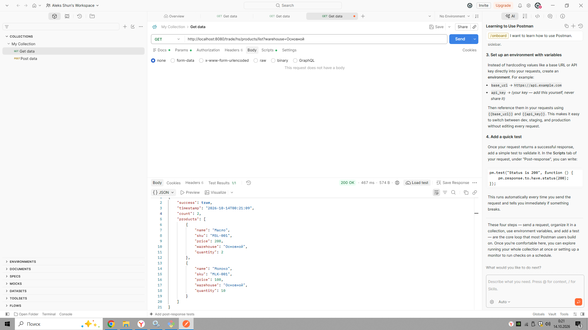
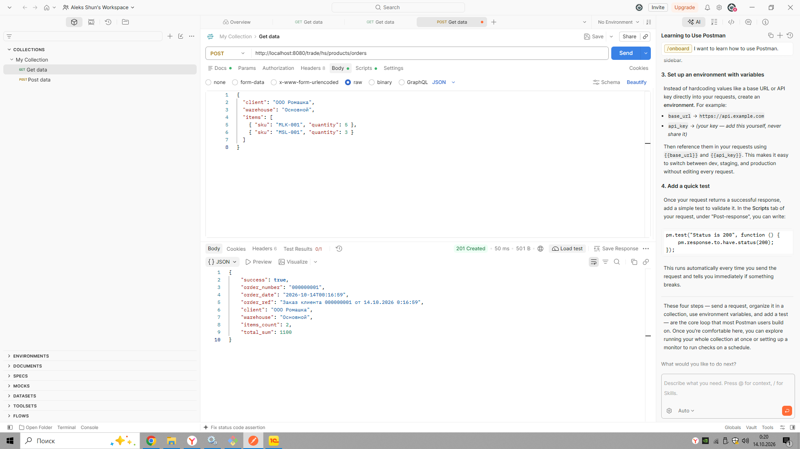

# 1C HTTP Service Pet Project

Pet-проект: HTTP-сервис на **1С:Предприятие 8.5**, развёрнутый под **Apache 2.4**.
Демонстрирует интеграцию 1С с внешними системами через REST-подобный API: отдача остатков в JSON и создание заказов из внешней системы.

---

## Что умеет

- **GET** `/hs/products/list` — возвращает остатки товаров по складам в формате JSON
- **Фильтрация** по складу через query-параметр `?warehouse=<имя>`
- **POST** `/hs/products/orders` — принимает заказ из внешней системы, создаёт документ «Заказ клиента» в 1С 
- **Корректные HTTP-коды** — 200, 201, 400, 404, 500
- **Валидация** входных данных и информативные сообщения об ошибках

---

## Скриншоты

### GET /hs/products/list


### POST /hs/products/orders


---

## Стек

| Компонент | Версия |
|---|---|
| 1С:Предприятие | 8.5 (учебная) |
| Apache HTTP Server | 2.4 (x86) |
| Модуль публикации 1С | `wsap24t.dll` |
| ОС | Windows |

---

## Как запустить

### 1. Развернуть Apache

Установить Apache 2.4 **x86** (разрядность должна совпадать с 1С), слушать порт **8080**.

### 2. Подключить модуль публикации 1С

В `httpd.conf` добавить:

```apache
LoadModule _1cws_module "C:/Program Files (x86)/1cv8t/<версия>/bin/wsap24t.dll"
```

### 3. Опубликовать базу

Через Конфигуратор: **Администрирование → Публикация на веб-сервере**.
Имя публикации: `trade`, тип: Apache 2.4.

Блок в `httpd.conf`:

```apache
Alias "/trade" "C:/Apache24/htdocs/trade"
<Directory "C:/Apache24/htdocs/trade">
    AllowOverride All
    Options None
    Require all granted
    SetHandler 1c-application
    ManagedApplicationDescriptor "C:/Apache24/htdocs/trade/default.vrd"
</Directory>
```

### 4. Проверить

```bash
curl http://localhost:8080/trade/hs/products/list
```

---

## API

### GET `/hs/products/list`

Получить остатки товаров.

| Параметр | Обязательный | Описание |
|---|---|---|
| `warehouse` | нет | Имя склада. Если не указан — возвращаются остатки по всем складам. |

**Пример запроса:**

```http
GET http://localhost:8080/trade/hs/products/list?warehouse=Основной
```

**Пример ответа (200 OK):**

```json
{
  "success": true,
  "timestamp": "2026-10-13T22:53:21",
  "count": 2,
  "products": [
    { "name": "Масло",  "price": 200, "warehouse": "Основной", "quantity": 2  },
    { "name": "Молоко", "price": 100, "warehouse": "Основной", "quantity": 10 }
  ]
}
```

**Ответ при ненайденном складе (404):**

```json
{
  "success": false,
  "error": "Склад не найден: Несуществующий"
}
```

---

## Структура репозитория

```
src/          — выгрузка конфигурации 1С в XML
docs/         — скриншоты, примеры запросов (планируется)
README.md     — документация проекта
```

---

## Автор

**Aleksandr Shunikhin**
GitHub: [@AlekSShuN](https://github.com/AlekSShuN)